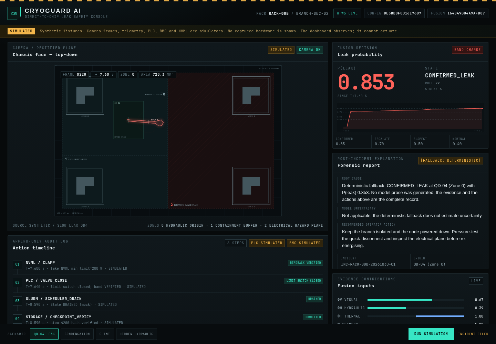

# CryoGuard AI

Verifiable liquid-cooling defense and thermal safety for 100 kW+ AI clusters.
A fluorescent camera watches the chassis face; a deterministic pipeline turns a
leak into a sealed incident, a closed valve, a saved checkpoint, and a powered-down
node. The language model writes the explanation **after** the incident is sealed.



> **Hackathon Evaluators:** Watch the [2-Minute Demo Video](https://youtu.be/YOUR_VIDEO_ID) | Complete provenance and commit audit in [HACKATHON_CONTRIBUTIONS.md](HACKATHON_CONTRIBUTIONS.md).
>
> **Everything shown is simulated or synthetic.** There is no camera, UV
> excitation, long-pass filter, tracer, real PLC/BMC, or host GPU in this
> repository. The four clips are generated by `scripts/make_sim_fixtures.py`.
> Every simulated surface is badged `SIMULATED` in the dashboard.

## Quick start

```bash
make setup          # pinned Python 3.11 environment from uv.lock
make check          # ruff, mypy strict (61 files), 515 passed in ~75s
make demo           # headless leak scenario -> incident JSON
make bench          # deterministic offline benchmark over every fixture
make serve          # dashboard at http://127.0.0.1:8080
```

`make serve` auto-runs the leak clip. Use `make serve SCENARIO=glint` for another
scenario, or `make serve SCENARIO=` to start idle.

## What runs

1. **Capture and rectification.** ArUco markers produce a homography; the frame
   is warped to a 600 × 400 mm top-down canvas at 2 px/mm.
2. **Perception.** A classical fluorescence tracker runs at 5–10 Hz. SAM 3.1 is
   an asynchronous refinement at ≤2 Hz, never in the decision path; a slow or
   dead API costs mask detail, not ticks. The cache is keyed by
   `sha256(pixel bytes + prompt + model)` — the raw crop, not an encoded PNG,
   because the same pixels compress to different bytes on different CPUs.
   `make sam-audit` records each live prompt (including zero-match lanes) in
   `artifacts/sam_live_audit.json` with `provenance: api`.
3. **Fusion.** `P = σ(1.85·φv + 2.10·φh + 1.25·min(φt,0) + 2.50·W − 2.80)`.
   The weights are hand-set priors, not calibrated coefficients.
4. **Decision.** A stateless rule table plus separate escalation and
   de-escalation hysteresis. `CONFIRMED_LEAK` and `EMERGENCY_TRIP` latch.
5. **Actuation.** Clamp readback → valve close → hydraulic isolation verification
   (limit switch **and** agreeing pressure/depressurized witnesses) → scheduler
   cordon → checkpoint verify → force off **verified by `PowerState=Off` readback**
   → requeue. A valve fault, a sensor disagreement, or a failed clamp escalates to
   a power cut; only a failed, unverified cut exits `FAILED_SAFE`. The R1
   emergency path deliberately runs valve → cordon → power cut without the clamp
   or checkpoint steps: the trigger is a hardware condition, coolant isolation is
   the priority, and there is no checkpoint to save.
6. **Watchdog.** Its own asyncio task reads the GPU directly and can trip
   `JUNCTION_OVER_TEMP`, `CLAMP_READBACK_FAILED`, `PLC_FAULT`,
   `SENSOR_UNAVAILABLE`, `SENSOR_STALE`, or a **corroborated** `SENSOR_FROZEN`
   without consuming a fusion decision. A repeated integer temperature alone is
   not a fault: `SENSOR_HEALTH_DEGRADED` is recorded without actuation, and a frozen
   reading must be corroborated by stuck power/utilization/clock channels under a
   sustained-load policy. A failed primary actuation triggers an independently
   constructed BMC `ForceOff` fallback that must verify `Off`; the trip is
   latched so duplicate triggers cannot repeat actuator commands.
7. **Report.** Meta Muse Spark Open may fill only `rootCauseExplanation`,
   `llmUncertainty`, and `llmModel`. It cannot change an action, the evidence, or
   the recommended operator action. Without a key, a timeout, a 5xx, or a
   malformed/truncated response, the deterministic report is returned unchanged
   (NFR-SAF-01). Truncation is classified from the provider's `finish_reason`
   rather than guessed.

## Dashboard

The console is vanilla HTML/CSS/ES modules with no build step, no npm, and no
runtime asset request (both typefaces are bundled under `ui/fonts/`). It is an
observer: `EventBus.publish` never raises, a dead browser tab cannot stop a valve
close, and the only mutating endpoint is `POST /api/run`.

It draws the chassis plane, the fusion inputs and the interlock sequence from the
event stream, and it can **rewind the incident**: `/api/state` carries the run's
event history, so dragging the P(leak) trace folds that history at a cursor and
re-renders the canvas, the decision, the telemetry and the actuation ladder at
that tick. Nothing is replayed from a recording of the screen.

- `GET /api/state` — topology, thresholds, manifest, run record, event history
- `GET /api/manifest` — every clip with its `source`
- `GET /api/incidents/{id}` — sealed incident JSON, read-only
- `WS /ws` — history replay, then live `FRAME_TICK`, `EVIDENCE_UPDATE`,
  `DECISION_CHANGE`, `ACTION_EXECUTED`, `INCIDENT_CLOSED`, `RUN_FINISHED`
- `POST /api/run` — start one scenario; `409` while another is running

See [ui/README.md](ui/README.md) for the event contract and the layout rules.

## Measured benchmark

`reports/benchmark.json` is the single authoritative source; the block below is
rendered from it by `make readme-sync` and checked in CI. Wall-clock samples live
separately in `reports/latency.json` and are flagged `deterministic: false`;
detection latency below is scenario time, not process wall time.

<!-- BENCH:BEGIN (generated from reports/benchmark.json) -->

**Deterministic Regression & Safety Verification Suite (4 Synthetic Scenarios)**

Config hash `f0781ebc586322ce` | run hash `98ac032bc7dc8b3d52954ef5d67f1da6e660c972e1aeb2e052ab3640b429d858` | fusion freeze `164849b04a9afb87` | split `all`

Automated Scenario Verification: 4/4 passing (2 positive detection scenarios, 2 negative control scenarios).

| Metric | Measured | 95 % Clopper–Pearson CI | Count |
| :--- | :--- | :--- | :--- |
| Leak detection recall | 100.0% (2/2) | [15.8%, 100.0%] | 2 positive clips |
| False positive rate | 0.0% (0/2) | [0.0%, 84.2%] | 2 negative clips |
| Detection latency (scenario time) | 5.55 s ± 2.90 s | — | 2 confirmed events |
| Spill-centroid localization (≤ 25.0 mm) | 0.0% (0/1) | [0.0%, 97.5%] | 1 localizable events |
| Mean spill-centroid error | 52.8 mm | — | 1 localizable events |
| Source estimate within tolerance | 100.0% (1/1) | [2.5%, 100.0%] | 1 of 4 clips estimated |
| Mean source error | 0.4 mm | — | 1 estimated events |
| Checkpoint recovery | 100.0% (1/1) | [2.5%, 100.0%] | 1 checkpointed incidents |
| Valve isolation verified | 100.0% (1/1) | [2.5%, 100.0%] | 1 commanded closes |

Fault-injection matrix (`tests/test_bench_faults.py`): **11/11 cases passing**, counted separately from the four scenario fixtures and never merged into the metrics above.

> Notice: Sample size n=4 across four synthetic benchmark fixtures. These results are deterministic regression verification of specified failure modes — recall X/Y with exact Clopper-Pearson intervals — not population performance estimates and not evidence of generalization to unmodeled data center environments.

<!-- BENCH:END -->

## Safety invariants enforced by tests

- The report layer cannot import the safety core, and the safety core cannot
  import `cryoguard.report` or `openai` (`tests/test_architecture.py`, `tests/test_adversarial_safety.py`).
- The LLM has no field for an actuation instruction; its response schema forbids
  extra keys.
- The incident completes with the report endpoint down; the fallback is not a
  toggle.
- The action log is append-only, ordered, sealed at close, and re-emitted only
  byte-identically.
- A valve that did not close is never reported as isolated; a power cut that was
  not accepted **and read back as `Off`** is never reported as powered down.
- Hydraulic isolation requires the limit switch and agreeing pressure witnesses;
  a contradictory sensor pair is `SENSOR_DISAGREEMENT`, never `VERIFIED`.
- A watchdog trip is latched, so duplicate triggers cannot send repeated actuator
  commands; a failed primary actuation attempts an independent BMC fallback that
  must verify `Off` before any success is claimed.
- A constant GPU temperature is not a sensor failure by itself; a freeze trip
  needs a corroborated multi-channel stuck trace under sustained load.
- Observing a run cannot change it: `tests/test_pipeline_events.py` runs the same
  clip with and without an event bus and compares incident bytes.

## Repository map

```text
src/cryoguard/
  capture/        video source, ArUco rectification, zone map
  perception/     classical tracker, SAM client/worker, camera health, sampling
  fusion/         features, rule table, hysteresis
  orchestrator/   incident FSM, emergency R1, watchdog, append-only actions
  adapters/       Modbus-TCP, Redfish, NVML, checkpoint, scheduler
  report/         deterministic fallback, Muse client, immutable writer
  bench/          offline runner, Clopper–Pearson, benchmark/latency reports
  events.py       typed event bus shared by headless and UI
  pipeline.py     composition root
  server.py       FastAPI observer dashboard
  app.py          headless CLI
configs/          safety config, topology, scenarios, prompts, dashboard
fixtures/         synthetic clips + manifest + SAM schema fixture
artifacts/        fixture SAM cache (committed), checkpoints/incidents (runtime)
reports/          fusion freeze, benchmark.json/md, latency.json
ui/               zero-build dashboard
```

## What is proven, and what is not

| Area | Status |
| :--- | :--- |
| Offline pipeline on four synthetic clips | Proven by `make check` and `make bench` |
| Deterministic replay and byte-identical incidents | Proven by tests and repeated runs |
| Modbus-TCP / Redfish clients | Exercised against loopback simulators over real sockets |
| Watchdog freeze/stale policy | Unit and pipeline tests; the real NVML `pynvml` path is not exercised on a GPU |
| NVML | Fake backend in the demo; the real `pynvml` path is not tested on a GPU |
| Hosted SAM 3.1 | Live endpoint authenticated and reached on 2026-10-31. The audit (configured `fluorescent yellow liquid droplet`, `bright green blob`, `yellow-green glow`) returned valid **zero-match** lanes on two synthetic crops; no live mask is claimed and the demo still uses the fixture cache. Earlier repository notes claimed masks for alternate prompts, but that result was not reproduced in this audit. Fixture and live provenance remain separate fields |
| Live Muse Spark Open on Baseten | 13 logged attempts for **one** incident (not 13 incidents): 2 schema-valid attempts, 11 malformed. Two attempts were confirmed live as `finish_reason=length` at the configured token cap, not inferred. The final attempt was a valid response, so the incident completed with `reportSource: llm`; the deterministic fallback remains the default on any failure |
| Real Redfish BMC | Not exercised: no BMC token or hardware; the loopback mock ignores auth |
| Physical capture | Not present: no camera, UV excitation, filter, or tracer |

## Configuration

Every tunable lives under `configs/`; no threshold is hidden in code. The safety
config is hashed into every incident (the current `configHash` is printed in the
generated benchmark block above), and `reports/fusion-freeze.json` locks the
fusion priors before the benchmark. A config change deliberately invalidates old
incident artifacts.
Dashboard runtime settings are in `configs/dashboard.yaml`, separate so a port
change cannot invalidate the safety freeze.

Secrets are local-only. Copy `.env.example` to `.env` and fill only the keys you
are using: `META_API_KEY` for live SAM, `BASETEN_API_KEY` for the Muse Spark
Open report (with optional `BASETEN_BASE_URL`, `BASETEN_MODEL`, and
`BASETEN_MAX_TOKENS=2400` for the reasoning model's headroom), and optional
`CRYOGUARD_BMC_TOKEN` for a real Redfish BMC. `MUSE_API_KEY` remains a
compatibility alias. `.env` is gitignored;
`make demo` and `make serve` load it automatically, and the process environment
wins over the file. `make env-check` prints presence, never a value. No secret is
committed, and the library/tests/benchmark never load `.env`.
