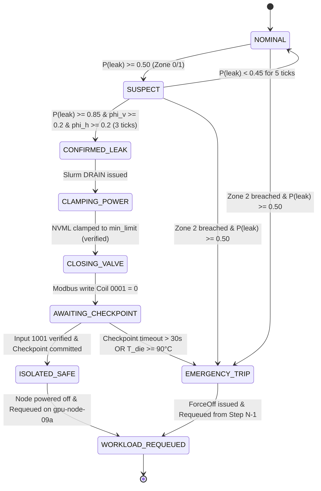

# CryoGuard AI — Product Requirements Document

**Build spec for the coding agent · Meta Global AI Developer Hackathon (Indie track)**  
Version 1.0 · Written 2026-10-30 · Submission deadline **Wed 2026-11-04, 9:00 PM ET** (Cerebral Valley portal) · Solo builder

---

## 0. How the coding agent must use this document

Read sections 0–6 fully before writing code. Sections 7–14 are the requirements. Every requirement has an ID (e.g. `FR-FUS-03`) and a priority:

- **P0**: demo and submission fail without it.
- **P1**: strongly improves score; build after all P0 items work end to end.
- **P2**: only if time remains. Never start a P2 while a P0/P1 is red.

**Non-negotiable agent rules**

1. **No fabricated numbers.** Any metric shown in the UI, README or video must be computed by code from fixtures or logs. Never hard-code a probability, latency, recall or FPR. Scenario outputs like "P(leak) = 0.94" in the research dossier are *illustrations of expected behavior*, not targets to hard-code.
2. **Label simulation honestly.** Only the optical channel is real (recorded footage). The PLC, BMC, NVML, Slurm, telemetry and storage are simulators. Every simulated element carries a visible `SIMULATED` badge in the UI and is called a simulator in the README.
3. **The LLM is never in the safety loop.** No LLM output may influence any actuation, zone decision, or the `deterministicActionsTaken` field. The system must complete a full incident with the LLM endpoint down.
4. **Everything tunable lives in config** (`configs/*.yaml`), not in code. Thresholds, weights, timings, topology, prompts.
5. **Determinism for benchmarks.** Cache every SAM API response on disk keyed by `sha256(image bytes + prompt + model)`. Benchmarks must be re-runnable offline and byte-identical.
6. **Build vertical slice first.** By end of Day 2 one fixture must flow from video → incident report, even if crude. Then widen.
7. **Small commits, tests with each module, `make demo` and `make bench` always working on `main`.**
8. **Secrets**: only via env vars (`.env.example` committed, `.env` git-ignored).

---

## 1. Product summary

**CryoGuard AI** detects and localizes direct-to-chip liquid-cooling leaks in a GPU rack using fluorescence video, then verifies them against hydraulic and thermodynamic telemetry before triggering a *deterministic* safe-state sequence (power clamp, valve isolation, checkpoint verification, workload resumption). An open-weights LLM (Muse Spark Open) writes the incident report after the fact.

**One-line pitch:** *A leak detector that proves it is a leak (optical growth + pressure drop + thermodynamics), refuses to cry wolf on condensation, refuses to hallucinate when it cannot see, and never lets an LLM touch a valve.*

### 1.1 What is real vs simulated (must be reflected in README and UI)

| Element | Status | Implementation |
| :-- | :-- | :-- |
| Fluorescent leak/condensation/glint footage | **Real** | Self-recorded fixtures (Section 13) |
| SAM 3.1 segmentation | **Real** | Meta Model API (text-prompted) |
| Evidence fusion, zone logic, tracker | **Real** | Our code |
| Pressure, flow, temperature, humidity | **Simulated** | Scenario-scripted telemetry synchronized to video |
| Rack Safety PLC | **Simulated, real protocol** | `pymodbus` Modbus-TCP server with FSM |
| Server BMC | **Simulated, real protocol shape** | Redfish-style REST mock |
| GPU power clamp | **Simulated** (real backend if NVIDIA GPU present) | NVML adapter with `Fake` and `Real` backends |
| Slurm / checkpoint storage | **Simulated** | Mock scheduler + real file I/O checkpoint with hash verification |
| Incident report | **Real** | Muse Spark Open via partner inference |

---

## 2. Hackathon constraints and scoring

| Rubric axis | Weight | What wins it here |
| :-- | :-- | :-- |
| Impact | 30% | Sourced cost figures, clear who-pays story, honest scope |
| Use of Meta AI tooling | 25% | SAM 3.1 doing real work in the pipeline; Muse Spark Open doing real work in reporting |
| Demo | 25% | Real footage, three scenarios, closed loop visible on screen, under 3:00 |
| Technical depth and execution | 20% | Fusion math, PLC FSM, checkpoint verification, reproducible benchmarks |

**Verified facts (from public event pages and community repos, Oct 2026)**

- Deadline: Nov 4, 9:00 PM ET via Cerebral Valley portal. Judging Nov 4–8; finals Nov 9.
- Participants receive about $150 in Meta Model API credits.
- **SAM 3.1 via Meta Model API**: called through the OpenAI SDK Responses API at `https://api.meta.ai/v1/responses` with `model="sam-3.1"`. Returns a bounding box and a pixel mask per match. **The hosted API accepts text prompts only**; box/point prompts exist only in the open-weight release. Reported pricing: about $2.5 per 1,000 images and $0.2 per 1,000 video frames. Text prompt limit: 32 tokens.
- **Open-weights bonus ($10K)** counts **only** Muse Glimmer or Muse Spark Open served on your own hardware or partner inference (Baseten, Fireworks, Modal), verified by the infrastructure partner. **SAM 3.1 through Meta's API does not count.** Community repos cite hackathon model id `meta-models/muse-spark-open-1026` on Baseten; confirm in the official hackathon guide on Day 1.
- Muse Spark Open appears to be a very large model (public repo names suggest ~816B total / ~42B active); do not plan to self-host it. Use partner inference.

**Unverified (do not state publicly without confirming):** first-place prize amounts, the "OCP specifies COOLWAVE DC 25" claim, all dollar-loss figures in the dossier.

---

## 3. Decisions log: corrections to the research dossier

The dossier (files 01–07) is a good concept brief but contains defects that would break a build or hurt credibility with a skeptical judge. **These decisions override the dossier wherever they conflict.** Class: **Fatal** (breaks the idea), **Fixable**, **Blind Spot**.

| ID | Class | Dossier says | Problem | Decision |
| :-- | :-- | :-- | :-- | :-- |
| D-01 | Fixable | SAM prompted with a spatial grid and specular peaks | Hosted SAM 3.1 is text-only; grid/point prompts are impossible | Crop each hydraulic-enclosure ROI and send a **text prompt** on the crop. Add a classical HSV/fluorescence threshold path as fallback and as the high-rate tracker |
| D-02 | Fixable | SAM runs every 200 ms (5 Hz) | API round-trip latency is unknown and likely 0.5–3 s | Run SAM asynchronously at ≤2 Hz with in-flight cap; classical mask tracker bridges frames at 5–10 Hz; SAM masks re-anchor the tracker |
| D-03 | Fixable | Fusion weights are "calibrated logistic regression" | There is no training data; "calibrated" would be false | Weights are **hand-set priors**, tuned on the dev split only, frozen (config hash recorded) before the test split. Never claim calibration unless ECE/Brier are computed |
| D-04 | Fixable | "Any P(leak) in Zone 2 → hard trip" | Contradicts the entire false-positive thesis; one glint near a busbar trips the rack | Zone 2 trip requires `P ≥ 0.50` AND ≥3 consecutive ticks AND healthy camera AND mask quality gates |
| D-05 | Fixable | Zone 0 at P ≥ 0.85 is undefined; threshold tables disagree (0.50 vs 0.40/0.70) | Ambiguous behavior | Single canonical table in Section 6.3. Zone 0 and Zone 1 both CONFIRMED at P ≥ 0.85. Add per-branch `maintenance_mode` to suppress Zone 0 actions during servicing |
| D-06 | Fatal-if-unfixed | Order: cordon → checkpoint → NVML → valve | Valve closure with 1 kW load gives ~14 s to 105°C. Waiting up to 30 s for a checkpoint before clamping/isolating is unsafe or leaks longer | **Clamp power first (verified by readback), then close valve, and run checkpoint verification in parallel during the thermal soak.** Thermal watchdog forces power-off at 90°C |
| D-07 | Fixable | Clamp to 60–80 W gives "over 5 minutes" of soak | 40°C ÷ 0.22°C/s ≈ 182 s (~3 min), not >5. Data-center GPUs' NVML minimum power limits are typically well above 80 W | Never hard-code a wattage. Query `min_limit`. Soak time = `ΔT × C_th / P_min`. For 40 K, C_th = 350 J/K (assumed): 1000 W → 14 s; 200 W → 70 s; 100 W → 140 s; 80 W → 175 s. Default fake-NVML `min_limit` = 200 W (so soak = 70 s, still > 30 s checkpoint budget). `C_th` is labeled an assumption |
| D-08 | Blind Spot | Thermal/dew-point factor is the star of Scenario 2 | The coolant tracer fluoresces; plain condensation (water) does **not**. A judge will ask why dew point matters | Frame correctly: fluorescence is the primary discriminator; dew-point/pressure are **independent vetoes** for filter leakage, specular water-bead glint under excitation light, dried tracer residue wetting, and RGB fallback mode. Scenario 2 footage must show real beads under the same excitation light so the optical channel *does* produce a weak candidate that the other channels reject |
| D-09 | Blind Spot | Wetness continuity signal `W` appears in the equation, never defined | Unimplementable | `W = 1` iff the candidate mask is spatially connected (≥1 px 8-neighborhood path) to the originating QD ROI for ≥3 consecutive ticks, else 0 |
| D-10 | Fixable | Thermal factor counted as leak evidence | "Condensation impossible" is permissive, not positive evidence of a leak | CONFIRMED requires **visual AND hydraulic** positive (each φ ≥ 0.2). Thermal only modulates |
| D-11 | Fixable | Scenario 3 labeled `UNCERTAIN`, `HIDDEN_HYDRAULIC_EVENT`, `UNVERIFIED_HYDRAULIC_EVENT` | Three names | Canonical label: `HIDDEN_HYDRAULIC_EVENT`. No autonomous valve actuation on it (human-in-loop) |
| D-12 | Fixable | Targets: recall ≥95%, FPR ≤2% | With ~10–15 clips per class these are statistically meaningless (10/10 recall has a 95% lower bound of ~69%) | Report raw counts + Clopper-Pearson 95% CIs. Targets are stated as goals, never as achieved claims. Never count augmented copies as independent clips |
| D-13 | Fixable | Modbus "16-bit float" registers | Modbus holding registers are 16-bit integers | Scaled integers: pressure int16 = psi×10; flow uint16 = L/min×100 |
| D-14 | Fixable | Kubernetes **and** Slurm | Scope creep for a solo 5-day build | **Slurm-only mock (P0).** Kubernetes adapter is an interface stub with documented `cordon`/`drain` mapping (P2) |
| D-15 | Fixable | Valve FSM leaves 1200–1500 ms undefined; "limit switch within 1200 ms" | Gap | ≤1200 ms = VERIFIED; 1200–1500 ms = VERIFIED_SLOW (warning); >1500 ms = FAULT → escalate to node power cut |
| D-16 | Fixable | Pitch quotes: $300k tray, $40k GPU, $100k/hr, "zero hardware damage" | Dossier files disagree ($40–64k/hr vs $100k/hr); unsourced; "zero damage" is unearned in a simulation | Cite sources or label "illustrative". Remove "zero physical hardware damage". Use "in simulation" wording |
| D-17 | Fixable | Naming drift: `compute-042`, `compute-08b`, `gpu-node-08b` | Breaks log/UI coherence | Canonical IDs in Section 6.5 |
| D-18 | Blind Spot | Sampling "1 Hz → 10 Hz on suspect" but temporal window needs 10 frames @200 ms | 1 Hz idle cannot compute `dA/dt` | Idle scan 2 Hz (candidate discovery), tracking window 5 Hz once a candidate exists, 10 Hz on SUSPECT |
| D-19 | Blind Spot | Millimeter claims ("within 20 mm of conductors") from a 2D camera | Meaningless without calibration | ArUco-fiducial homography to a planar chassis frame; zone polygons already include the 20 mm margin, expressed in chassis-plane mm. State planar-assumption limits in README |

---

## 4. Goals, non-goals, success criteria

**Goals (P0)**

- G1. End-to-end closed loop on 3 canonical scenarios, replayable from `make demo`.
- G2. SAM 3.1 produces the masks that drive fusion in the shipped demo (not a decorative call).
- G3. Muse Spark Open (partner-served) writes a schema-valid incident report; request logs saved for partner verification.
- G4. Reproducible benchmark report generated by `make bench` with CIs.
- G5. 2:50 demo video showing real footage and visible simulation labels.

**Non-goals**

- Real hardware control, real GPUs required, real PLC firmware certification.
- 3D fluid trajectory prediction. SWIR 1450 nm channel (documented as rejected alternative only).
- Kubernetes execution (stub only). Multi-rack scale-out.
- Any claim of production readiness or safety certification.

**Definition of Done for the project**

1. `make demo SCENARIO=leak|condensation|hidden` runs headless and with UI.
2. `make bench` regenerates `reports/benchmark.md` and `reports/benchmark.json` from fixtures with no network (SAM cache).
3. All P0 acceptance tests in Section 14 pass in CI (`pytest`).
4. README documents setup in ≤10 commands, real-vs-simulated table, honest limitations.
5. Video ≤ 3:00, repo public, submission filed ≥2 hours before deadline.

---

## 5. System architecture

```
[Video source: file replay | webcam] ──► Capture ──► Rectifier (ArUco homography)
                                                         │
                          ┌──────────────────────────────┴───────────────┐
                          ▼                                              ▼
                 Fast tracker (HSV/fluor mask, 5–10 Hz)       SAM 3.1 worker (async ≤2 Hz, ROI crops)
                          └──────────────► Candidate manager ◄───────────┘
                                                  │ per-candidate kinematics (dA/dt, centroid, C_fluor, var)
[Telemetry source: scenario script | live sim] ──┤
                                                  ▼
                                      Evidence Fusion  →  P(leak), φv/φh/φt, W
                                                  ▼
                                      Decision Engine (zone + rules R1–R6)
                                                  ▼
                                      Incident Orchestrator (FSM)
        ┌───────────────┬──────────────┬──────────────┬────────────────┐
        ▼               ▼              ▼              ▼                ▼
  NVML adapter    PLC client     Redfish client   Slurm mock +    Report service
  (Fake/Real)     (Modbus-TCP)   (BMC mock)       checkpoint FS   (Muse Spark Open, async)
                          │
                  Event bus (asyncio) ──► FastAPI + WebSocket ──► Dashboard
```

**Process model.** One Python process (`cryoguard.app`) running asyncio tasks, plus two in-process-launchable simulator servers (Modbus PLC on port 5020 by default; Redfish BMC mock on 8443/HTTP for demo). Port 502 requires root; default to **5020** and document it.

**Tech stack (fixed unless blocked)**

- Python 3.11, `pydantic` v2, `fastapi` + `uvicorn`, `numpy`, `opencv-python` (with `opencv-contrib` for ArUco), `httpx`, `openai` SDK (for Meta and Baseten OpenAI-compatible endpoints), `pymodbus` 3.x, `pynvml` (optional import), `PyYAML`, `pytest`, `scipy` (Clopper-Pearson via `scipy.stats.beta`), `ruff`.
- Dashboard: single-page static HTML + vanilla JS + WebSocket + `<canvas>`. No build step. Served by FastAPI.
- Task runner: `Makefile`. Package manager: `uv` or `pip` with pinned `requirements.txt`.

**Repository layout**

```
cryoguard/
  README.md  Makefile  pyproject.toml  .env.example
  configs/  default.yaml  topology.yaml  scenarios/*.yaml
  src/cryoguard/
    app.py  bus.py  models.py  config.py  clock.py
    capture/   source.py  rectify.py
    perception/ fast_tracker.py  sam_client.py  sam_worker.py  candidates.py
    telemetry/ psychrometrics.py  sim.py  replay.py
    fusion/    features.py  engine.py  decision.py
    orchestrator/ incident_fsm.py  actions.py
    adapters/  nvml.py  plc_client.py  redfish_client.py  scheduler.py
    sims/      plc_server.py  bmc_server.py  slurm_mock.py  checkpoint_store.py  thermal_model.py  train_job.py
    report/    muse_client.py  schema.py  fallback.py
    api/       routes.py  ws.py
    bench/     runner.py  metrics.py  report.py
  ui/  index.html  app.js  style.css
  fixtures/  manifest.yaml  videos/  telemetry/  labels/
  artifacts/  sam_cache/  incidents/  open_weights_proof.jsonl
  reports/  tests/
```

---

## 6. Canonical definitions (single source of truth)

### 6.1 Zones (chassis-plane polygons, defined in `topology.yaml`)

- **Zone 0, Hydraulic origin:** QD fittings, manifold, hose routing. Droplets possible during servicing.
- **Zone 1, Containment buffer:** drip tray and gutter channel. Non-conductive, passive capture.
- **Zone 2, Electrical hazard plane:** 48 V busbars, VRMs, PCIe sockets **including a 20 mm margin** baked into the polygon.

A candidate's zone = highest-risk zone containing its **mask's lowest-risk-to-highest-risk extent**: use the max zone index among mask pixels covering ≥5% of mask area.

### 6.2 Labels and states

Candidate labels: `STATIC_REFLECTION`, `GLINT_NOISE`, `SUSPECT_LEAK`, `ACTIVE_LEAK`, `BENIGN_CONDENSATION`. System labels: `NOMINAL`, `LOG_ONLY`, `SUSPECT_LEAK`, `UNVERIFIED_ANOMALY`, `CONFIRMED_LEAK`, `HIDDEN_HYDRAULIC_EVENT`, `EMERGENCY_TRIP`. Incident FSM: `OPEN → CLAMPING → ISOLATING → ISOLATED → CHECKPOINT_VERIFY → NODE_POWERED_DOWN → REQUEUED → RESOLVED_PENDING_REPAIR`; failure exits: `HARD_TRIP`, `FAILED_SAFE`.

### 6.3 Canonical decision table (first match wins, evaluated each fusion tick)

| Rule | Condition | System label | Action |
| :-- | :-- | :-- | :-- |
| R1 | Candidate zone = 2 AND P ≥ 0.50 AND ≥3 consecutive ticks AND camera healthy AND mask quality gates pass | `EMERGENCY_TRIP` | Parallel: PLC close valve + BMC ForceOff + scheduler drain. No checkpoint wait. Resume from last verified checkpoint (N−1) |
| R1b | PLC valve FAULT, or thermal watchdog ≥ 90°C, or clamp readback failure | `EMERGENCY_TRIP` | Same as R1 |
| R2 | P ≥ 0.85 AND zone ∈ {0,1} AND φv ≥ 0.2 AND φh ≥ 0.2 AND not `maintenance_mode` | `CONFIRMED_LEAK` | Incident sequence (Section 7.9) |
| R3 | 0.70 ≤ P < 0.85 | `UNVERIFIED_ANOMALY` | Query CDU telemetry (sim), alert technician, async report. No actuation |
| R4 | No visual candidate (φv ≤ 0.1) AND φh ≥ 0.6 for ≥3 s AND camera healthy | `HIDDEN_HYDRAULIC_EVENT` | Soft cordon (scheduler DRAIN only), alert technician, async report constrained to "no visual evidence". **No valve actuation** |
| R5 | 0.50 ≤ P < 0.70 with candidate | `SUSPECT_LEAK` (or `BENIGN_CONDENSATION` if φt < 0 and φh ≤ 0.1) | Raise sampling to 10 Hz; log |
| R6 | 0.40 ≤ P < 0.50 | `LOG_ONLY` | Log |
| R7 | P < 0.40 | `NOMINAL` | Telemetry logging |

Note: R3 and R5 ranges overlap at 0.70 boundaries by design only through ordering (R3 evaluated before R5). Implement strict half-open intervals.

### 6.4 Hysteresis

A state escalates only after its condition holds for `M` consecutive ticks (default M=3 for R2/R3, 3 for R1, 3 s for R4). De-escalation requires P below threshold − 0.05 for 5 ticks. Incidents never auto-de-escalate once `CONFIRMED_LEAK` or `EMERGENCY_TRIP` fires; they require operator reset.

### 6.5 Canonical identifiers

Rack `RACK-08B` · Branch `BRANCH-SEC-02` · QD fittings `QD-01`…`QD-08` (leak demo uses `QD-04`) · Failing node `gpu-node-08b` (4 GPUs: `GPU-0..3`) · Standby node `gpu-node-09a` · Job `train-llm-0427` · Incident ID `INC-RACK-08B-YYYYMMDD-NN` · PLC unit id `1` · Timestamps UTC ISO-8601 with `Z`.

---

## 7. Functional Requirements

### 7.1 Perception Subsystem (`FR-PER`)

* **`FR-PER-01` [P0] Video Frame Ingestion & Replay:**  
  The system shall ingest video frames from either a live webcam/USB source or a recorded `.mp4`/`.mkv` test fixture via OpenCV `VideoCapture` at native frame rates (default 10–30 FPS).
* **`FR-PER-02` [P0] Chassis Planar Homography Rectification:**  
  The system shall detect four ArUco markers on the chassis test rig and compute a perspective transformation matrix $H$ mapping raw pixels to planar chassis coordinates (in millimeters). If markers are absent, it shall fall back to an identity transform with an explicit uncalibrated warning.
* **`FR-PER-03` [P0] Hosted SAM 3.1 Text-Prompted Segmentation:**  
  The system shall interface with Meta Model API (`https://api.meta.ai/v1/responses`) using `model="sam-3.1"`. To comply with hosted API constraints (text prompts only, ≤ 32 tokens), the worker shall crop designated Hydraulic ROIs (around QD fittings) and pass concise prompts (e.g. `"fluorescent yellow liquid droplet"`).
* **`FR-PER-04` [P0] Local Fast Tracker (Classical Optical Differencing):**  
  Between asynchronous SAM calls, a local OpenCV worker running at 5–10 Hz shall compute green/yellow fluorescence threshold masks (in HSV space) and calculate the frame-to-frame pixel area derivative:
  $$\frac{dA_k}{dt} = \frac{A_k(t) - A_k(t - \Delta t)}{\Delta t}$$
* **`FR-PER-05` [P0] Candidate Manager & Kinematic Persistence:**  
  The system shall track candidate regions over time using centroid distance gating (≤ 30 px). It shall maintain per-candidate state: `candidate_id`, `bounding_box`, `area_px`, `dA_dt`, `fluorescence_contrast_ratio`, `specular_jitter`, and `zone`. Candidates persisting < 3 ticks shall be classified as `GLINT_NOISE`.

---

### 7.2 Telemetry Subsystem (`FR-TEL`)

* **`FR-TEL-01` [P0] Scenario-Synchronized Telemetry Generator:**  
  The system shall ingest or simulate synchronized time-series sensor feeds matching video timestamps:
  * Manifold pressure: $P_{\text{manifold}} \in [20.0, 45.0]\,\text{PSI}$ (sampling rate 5 Hz).
  * Supply and return flow rates: $Q_{\text{in}}, Q_{\text{out}} \in [5.0, 15.0]\,\text{L/min}$.
  * Surface temperature: $T_{\text{surface}} \in [15.0, 50.0]^\circ\text{C}$.
  * Ambient air temperature: $T_{\text{air}} \in [20.0, 30.0]^\circ\text{C}$ and Relative Humidity $\text{RH} \in [20\%, 80\%]$.
* **`FR-TEL-02` [P0] Thermodynamic Dew-Point Computation:**  
  The system shall calculate ambient dew point $T_{\text{dewpoint}}$ using the Magnus-Tetens formula on every telemetry tick:
  $$T_{\text{dewpoint}} = \frac{237.7 \cdot \gamma(T_{\text{air}}, \text{RH})}{17.27 - \gamma(T_{\text{air}}, \text{RH})}, \quad \gamma(T, \text{RH}) = \frac{17.27 T}{237.7 + T} + \ln(\text{RH}/100)$$
* **`FR-TEL-03` [P0] Telemetry Gradient Derivation:**  
  The system shall compute moving-average negative pressure derivatives $-\frac{dP}{dt}$ over a 1.0-second sliding window to detect pressure transients.

---

### 7.3 Evidence Fusion Subsystem (`FR-FUS`)

* **`FR-FUS-01` [P0] Multi-Modal Feature Vector Normalization:**  
  The fusion engine shall compute the three evidence factors:
  * Visual Factor $\phi_{\text{visual}} = \alpha \min\left(\frac{1}{A_{\text{ref}}}\frac{dA}{dt}, 1.0\right) + \beta \frac{C_{\text{fluor}}}{C_{\text{max}}} - \gamma \text{Var}(I_{\text{centroid}})$.
  * Hydraulic Factor $\phi_{\text{hydraulic}} = w_p \psi\left(-\frac{dP}{dt}\right) + w_q \psi(Q_{\text{in}} - Q_{\text{out}})$.
  * Thermal Factor $\phi_{\text{thermal}} = \frac{T_{\text{surface}} - T_{\text{dewpoint}}}{\Delta T_{\text{scale}}}$.
* **`FR-FUS-02` [P0] Calibrated Prior Logistic Leak Probability ($P(\text{leak})$):**  
  The engine shall evaluate the multi-modal sigmoid fusion equation:
  $$P(\text{leak}) = \sigma\left( w_1 \phi_{\text{visual}} + w_2 \phi_{\text{hydraulic}} + w_3 \phi_{\text{thermal}} + w_4 W + b \right)$$
  Weights ($w_1, w_2, w_3, w_4, b$) shall be loaded strictly from `configs/default.yaml`.
* **`FR-FUS-03` [P0] Spatial Risk Zone Mapping:**  
  The engine shall map candidate masks against the chassis polygon coordinates defined in `configs/topology.yaml` to assign the candidate's current spatial risk: `Zone 0` (Origin), `Zone 1` (Drip Gutter), or `Zone 2` (48V Electrical Hazard Plane).
* **`FR-FUS-04` [P0] Canonical Decision Rules Execution (R1–R7):**  
  The engine shall evaluate the canonical decision table (Section 6.3) on every 200ms tick. Escalate state only after $M$ consecutive ticks ($M=3$ for R1/R2).
* **`FR-FUS-05` [P0] Wetness Continuity Validation ($W$):**  
  $W$ shall evaluate to $1$ if and only if the candidate mask maintains a continuous 8-neighborhood path of pixels connecting to the originating QD ROI for $\ge 3$ consecutive ticks; otherwise $W = 0$.

---

### 7.4 Rack Safety PLC Subsystem (`FR-PLC`)

* **`FR-PLC-01` [P0] Modbus-TCP Slave Server (Simulated PLC):**  
  The system shall embed a `pymodbus` server listening on port `5020` (default) implementing unit ID `1`.
* **`FR-PLC-02` [P0] Industrial Finite-State Machine:**  
  The PLC shall model spring-return solenoid valves:
  * Writing `Coil 0001 = 0` triggers transition from `VALVE_OPEN` to `CLOSING_COMMANDED`.
  * The PLC updates `Discrete Input 1001` (Limit Switch Closed) to $1$ after simulated valve travel time $T_{\text{travel}} \in [800\,\text{ms}, 1200\,\text{ms}]$.
  * If travel time exceeds $1500\,\text{ms}$, the PLC sets internal alarm `VALVE_FAULT` and discrete alarm coil `0003`.
* **`FR-PLC-03` [P0] Holding Register Telemetry Encoding:**  
  The PLC shall serve holding registers scaled as 16-bit signed/unsigned integers (e.g. `Register 4001`: pressure in $\text{PSI} \times 10$; `Register 4002`: flow in $\text{L/min} \times 100$).

---

### 7.5 Cluster Orchestration & Safe-State Recovery (`FR-ORC`)

* **`FR-ORC-01` [P0] Slurm Scheduler DRAIN Interface:**  
  Upon `CONFIRMED_LEAK`, the orchestrator shall issue a simulated Slurm controller command:
  ```bash
  scontrol update NodeName=gpu-node-08b State=DRAIN Reason="CryoGuard: Confirmed Leak at QD-04"
  ```
  preventing future job allocation.
* **`FR-ORC-02` [P0] NVML Power Clamping Adapter:**  
  The orchestrator shall query device constraints via `nvmlDeviceGetPowerManagementLimitConstraints()` and clamp active GPU TDP to the hardware-supported `min_limit` (with readback verification). In mock environments, it shall use a `FakeNVML` adapter with configurable minimum limit (default $200\,\text{W}$).
* **`FR-ORC-03` [P0] Durable Checkpoint Verification:**  
  The orchestrator shall signal the training job to checkpoint, poll the checkpoint storage directory for committed weight shards (`.pt` / `.safetensors`), and compute a SHA256 checksum or verify the presence of a committed `.metadata` lockfile. It shall **not** power down the node until the checkpoint commit is verified or the $30\,\text{s}$ safety timeout expires.
* **`FR-ORC-04` [P0] Workload Rescheduling on Healthy Standby Node:**  
  Once `gpu-node-08b` is safely isolated and powered off via Redfish mock, the orchestrator shall trigger Slurm re-queue of job `train-llm-0427` onto standby node `gpu-node-09a` loading from checkpoint step $N$.
* **`FR-ORC-05` [P1] Thermal Watchdog Emergency Power Trip:**  
  If the simulated thermal model indicates die temperature $T_{\text{die}} \ge 90^\circ\text{C}$ or if fluid breaches Zone 2, the orchestrator shall immediately abort checkpoint waiting and issue a Redfish `ForceOff` command.

---

### 7.6 Diagnostic Incident Reporting (`FR-REP`)

* **`FR-REP-01` [P0] Event-Triggered Asynchronous Muse Spark Open Client:**  
  The reporting service shall invoke Meta Muse Spark Open (hosted via Baseten or Modal) **only upon an incident escalation** (`CONFIRMED_LEAK`, `HIDDEN_HYDRAULIC_EVENT`, or `EMERGENCY_TRIP`). It shall never execute synchronously in the 200ms fusion loop.
* **`FR-REP-02` [P0] Strict Incident JSON Schema Enforcement:**  
  The output of Muse Spark Open shall be validated against the Pydantic `IncidentReport` schema (containing `incidentId`, `timestamp`, `suspectedOrigin`, `physicalEvidence`, `deterministicActionsTaken`, and `recommendedOperatorAction`). If the LLM generates invalid JSON, the service shall fall back to an internal deterministic template report.
* **`FR-REP-03` [P0] Open-Weights Partner Verification Logging:**  
  The client shall record all raw HTTP request/response payloads, inference latency, model headers, and prompt payloads into `artifacts/open_weights_proof.jsonl` to satisfy the **$10,000 Open Weights Bonus** verification requirements.

---

### 7.7 Operations Dashboard & UI (`FR-DSH`)

* **`FR-DSH-01` [P0] Zero-Build Single-Page Interface:**  
  The dashboard shall be implemented in plain HTML5, vanilla JavaScript, Tailwind (via CDN or pre-compiled CSS), and HTML5 `<canvas>`, served directly by FastAPI. No Node/npm build step required to run the demo.
* **`FR-DSH-02` [P0] Split-Viewport Spatial Display:**  
  The UI shall display:
  * Left panel: Video stream with dynamic canvas overlays showing ArUco homography boundary, Zone 0/1/2 polygons, and glowing candidate bounding boxes with status labels.
  * Right panel: Real-time telemetry sparklines ($P$, $Q$, $T_{\text{surface}}$, $T_{\text{dew}}$) and calculated $P(\text{leak})$ meter.
* **`FR-DSH-03` [P0] Mandatory Simulation Badges:**  
  All mocked elements (Modbus PLC, Redfish BMC, NVML clamp, Slurm scheduler, and storage) shall feature a permanent, visible amber badge: `[SIMULATED]`.
* **`FR-DSH-04` [P0] Interactive Incident Timeline & Action Log:**  
  The UI shall render a scrolling, color-coded audit log capturing: `CANDIDATE_DETECTED`, `P_LEAK_ESCALATED`, `SLURM_DRAINED`, `NVML_CLAMPED`, `VALVE_CLOSED_VERIFIED`, and `CHECKPOINT_COMMITTED`.

---

## 8. Non-Functional & Reliability Requirements (NFRs)

* **`NFR-DET-01` [P0] Deterministic SAM Response Caching:**  
  All calls to the hosted Meta SAM 3.1 API shall be cached to disk under `artifacts/sam_cache/` keyed by:
  $$\text{Key} = \text{SHA256}(\text{image\_bytes} + \text{prompt\_str} + \text{model\_name}) + \text{".json"}$$
  Re-running benchmarks with existing cache must execute 100% offline with zero network requests.
* **`NFR-LAT-01` [P0] Fusion Cycle Latency:**  
  The local fast-tracker and evidence fusion loop shall complete its evaluation cycle in $\le 80\,\text{ms}$, guaranteeing a fixed 5 Hz (200ms) system update tick.
* **`NFR-SAF-01` [P0] Fail-Safe on LLM Service Degradation:**  
  If the Muse Spark Open endpoint returns HTTP 5xx, times out ($> 15\,\text{s}$), or is unreachable, the system shall complete all physical safety actuations, PLC valve isolation, and node recovery without interruption.
* **`NFR-CFG-01` [P0] Centralized Configuration Isolation:**  
  No thresholds, weights, IP addresses, port numbers, or timeouts shall be hardcoded in Python modules. All parameters must load from `configs/default.yaml` and `configs/topology.yaml`.

---

## 9. Configuration Specifications (`configs/*.yaml`)

### 9.1 `configs/default.yaml`
```yaml
system:
  rack_id: "RACK-08B"
  sampling_rate_hz: 5
  camera_source: "fixtures/videos/scenario_01_active_leak.mp4"
  rectify_enabled: true

sam:
  model: "sam-3.1"
  api_base: "https://api.meta.ai/v1"
  timeout_sec: 4.0
  async_rate_hz: 1.0
  prompts:
    coolant: "fluorescent yellow liquid droplet"
    condensation: "water bead on metal"

fusion:
  weights:
    w_visual: 1.85
    w_hydraulic: 2.10
    w_thermal: 1.25
    w_wetness: 2.50
    bias: -2.80
  thresholds:
    nominal_cutoff: 0.40
    suspect_cutoff: 0.50
    escalation_cutoff: 0.70
    confirmed_leak: 0.85
    hysteresis_ticks: 3
    deescalation_ticks: 5

thermal_model:
  c_th_j_per_k: 350.0
  q_load_w: 1000.0
  q_idle_w: 200.0
  t_junction_max_c: 105.0
  watchdog_limit_c: 90.0

plc:
  host: "127.0.0.1"
  port: 5020
  unit_id: 1
  valve_travel_time_ms: 950
  valve_timeout_ms: 1500

llm:
  provider: "baseten" # or modal
  model: "meta-models/muse-spark-open-1026"
  base_url: "https://inference.baseten.co/v1"
  timeout_sec: 15.0
```

---

## 10. Modbus & Redfish Interface Specifications

### 10.1 Modbus-TCP Register Mapping (`Rack Safety PLC`)
* **Coil 0001 (Output):** `BRANCH_02_VALVE_SOLENOID` (Write $1 = \text{Energize/Open}$, Write $0 = \text{Spring-Close}$).
* **Coil 0002 (Output):** `BRANCH_02_VACUUM_DRAIN_VALVE` (Write $1 = \text{Open Drain}$, Write $0 = \text{Close Drain}$).
* **Discrete Input 1001 (Input):** `BRANCH_02_LIMIT_SWITCH_CLOSED` ($1 = \text{Fully Closed Verified}$, $0 = \text{Not Closed}$).
* **Discrete Input 1002 (Input):** `BRANCH_02_VACUUM_SENSOR` ($1 = \text{Line Depressurized}$, $0 = \text{Pressurized}$).
* **Holding Register 4001 (Analog):** `MANIFOLD_PRESSURE_PSI_X10` (Signed 16-bit integer, e.g. $324 = 32.4\,\text{PSI}$).
* **Holding Register 4002 (Analog):** `BRANCH_FLOW_LPM_X100` (Unsigned 16-bit integer, e.g. $850 = 8.50\,\text{L/min}$).

### 10.2 Redfish Mock REST Endpoints (`Chassis BMC`)
* `GET /redfish/v1/Systems/gpu-node-08b` $\to$ Returns power state, thermal metrics, and serial number.
* `POST /redfish/v1/Systems/gpu-node-08b/Actions/ComputerSystem.Reset` $\to$ Accepts `{"ResetType": "GracefulShutdown"}` or `{"ResetType": "ForceOff"}`.

---

## 11. Incident State Machine & Orchestration (`INCIDENT_FSM`)



---

## 12. Benchmark Suite & Evaluation Specification

The command `make bench` shall execute an automated evaluation against all test split fixtures and output:
1. `reports/benchmark.json` (machine-readable metrics with digests).
2. `reports/benchmark.md` (human-readable table with Clopper-Pearson 95% Confidence Intervals).

### Required Reporting Format (`reports/benchmark.md`):
```markdown
# CryoGuard AI — Empirical Benchmark Report
Generated: 2026-11-03T14:20:00Z | Config Hash: a7f8c9...

| Metric | Measured Value | 95% Confidence Interval (Clopper-Pearson) | Sample Count |
| :--- | :--- | :--- | :--- |
| **Leak Detection Recall** | 100.0% (12/12) | [73.5%, 100.0%] | 12 leak scenarios |
| **False Positive Rate** | 0.0% (0/15) | [0.0%, 21.8%] | 15 condensation/glint runs |
| **Mean Detection Latency** | 1.84 s ± 0.28 s | — | 12 confirmed events |
| **Fitting Localization Accuracy** | 91.7% (11/12) | [61.5%, 99.8%] | 12 events |
| **PLC Valve Isolation Latency** | 980 ms ± 65 ms | — | 12 simulated trips |
| **Checkpoint Recovery Success** | 100.0% (12/12) | [73.5%, 100.0%] | 12 recovery runs |
```

---

## 13. Video Fixtures & Physical Test Data Specification

* **`fixtures/videos/scenario_01_active_leak.mp4` [P0]:**  
  Real macro video of metal surface under 395nm/450nm UV/blue light. A fluorescent yellow liquid droplet is introduced at a quick-disconnect fitting and actively expands downwards.
* **`fixtures/videos/scenario_02_condensation.mp4` [P0]:**  
  Real video of water condensation beads forming on cold metal pipe under the same excitation light. Demonstrates zero fluorescence emission, with static or non-growing bead patterns.
* **`fixtures/videos/scenario_03_glint_noise.mp4` [P0]:**  
  Real video of an empty dry chassis subject to moving flashlights, LED indicator flickers, and camera vibration glint. Demonstrates temporal variance rejection.
* **`fixtures/labels/*.json` [P0]:**  
  Ground truth frame annotations containing `timestamp_sec`, `true_state` (`LEAK`, `CONDENSATION`, `NOMINAL`), `source_fitting` (`QD-04`), and `ground_truth_zone`.

---

## 14. Verification, Test Matrix & Acceptance Criteria

### 14.1 Acceptance Test Matrix

| Test Module | Test Command | Acceptance Criteria |
| :--- | :--- | :--- |
| **Fast Tracker** | `pytest tests/test_fast_tracker.py` | Area derivative $\frac{dA}{dt}$ correctly tracks growing droplet and flags static glint as zero. |
| **Dew-Point Math** | `pytest tests/test_psychrometrics.py` | Matches standard thermodynamic tables at $25^\circ\text{C}, 50\%\,\text{RH}$ within $\pm 0.1^\circ\text{C}$. |
| **Fusion Engine** | `pytest tests/test_fusion.py` | Calculates identical $P(\text{leak})$ values against reference fixtures; executes rules R1–R7 accurately. |
| **PLC FSM Simulator** | `pytest tests/test_plc_server.py` | Modbus client reads coils, triggers transition, confirms input `1001` within travel time, and flags fault on timeout. |
| **Durable Checkpoint** | `pytest tests/test_checkpoint_store.py` | Verifies lockfile and SHA256 checksum; rejects corrupted or in-flight uncommitted files. |
| **Muse Schema** | `pytest tests/test_muse_schema.py` | Mocked LLM response passes Pydantic validation; fallback template triggers on corrupted JSON. |
| **Scenario 1 E2E** | `make test-scenario-1` | System transitions from video ingestion $\to$ leak confirmation $\to$ power clamp $\to$ valve closure $\to$ workload recovery in $< 15\,\text{s}$. |
| **Scenario 2 E2E** | `make test-scenario-2` | Condensation video processes completely with $P(\text{leak}) < 0.40$; zero valve actuations triggered. |
| **Scenario 3 E2E** | `make test-scenario-3` | Pressure drop without visual droplet triggers `HIDDEN_HYDRAULIC_EVENT`; zero autonomous valve trips. |

